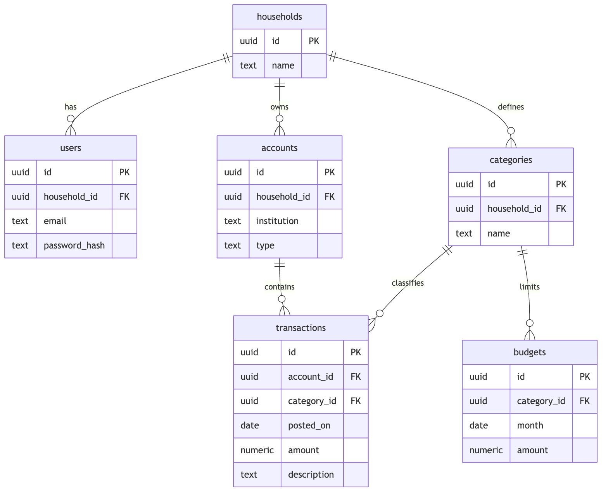
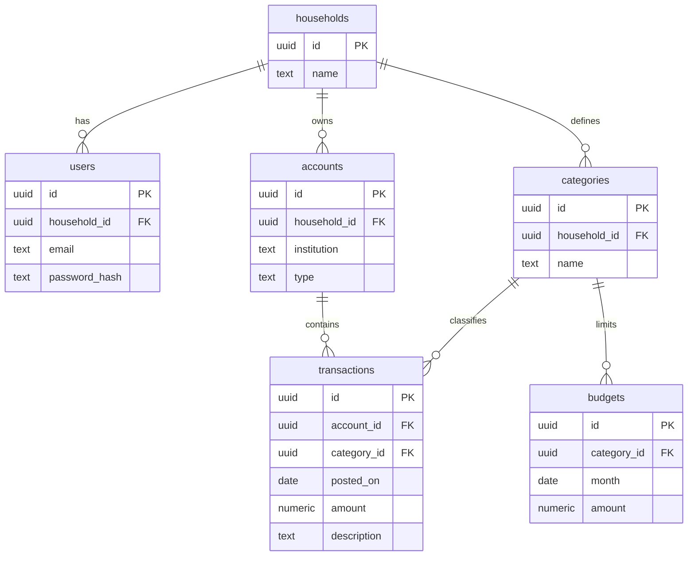
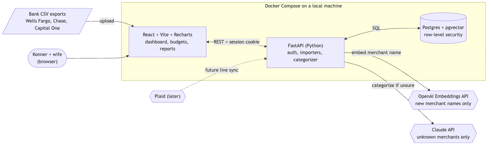

# BudgetApp: Initial Design

CS 452 Final Project. A private budgeting app for a household.

## 1. Project summary

### Purpose
My wife and I want to see where our money actually goes. Our spending is spread across a Wells Fargo bank account and Chase and Capital One credit cards, and tracking it by hand in a spreadsheet doesn't last. BudgetApp pulls those transactions into one place, sorts them into categories automatically, and tells us whether we're staying within the budget we set.

I plan to keep using it after the class, so it needs to be updateable and, above all, safe with our financial data.

### What it does
1. **Import:** upload CSV exports from Wells Fargo, Chase and Capital One (live bank sync through Plaid is a later goal).
2. **Categorize:** every transaction is sorted into a category such as Gas, Groceries or Restaurants.
3. **Budget:** we set a monthly amount for each category.
4. **See how we're doing:** a dashboard shows spending against budget for each category.
5. **Monthly report:** shows how we did and suggests adjustments, such as "Restaurants was over budget two months in a row".

### Goals
- Replace manual spreadsheet tracking for two people sharing finances.
- Categorize automatically and **learn from my corrections**, so it needs less help over time.
- **Keep financial data safe:** it runs locally, never stores bank logins, and the repo holds no real data. The demo uses fake data.
- **Support multiple households:** anyone can use it with their own accounts and see only their own data.
- Meet the class requirements: reads and writes data, uses AI, and takes 30-40 hours.

### How categorizing works
Messy bank text such as `SQ *BLUE BOTTLE #123` has to become "Restaurants". Each transaction goes through three steps, and the first one that is confident wins:
1. **Rules:** exact or keyword matches I define ("CHEVRON" is Gas).
2. **Embeddings:** the merchant name is turned into a vector and compared with merchants I've already categorized, so `TST* Blue Bottle Coffee` matches `SQ *BLUE BOTTLE`. This runs in Postgres with pgvector.
3. **Claude:** only for merchants nothing else recognized. It is sent just the merchant name.

When I correct a category, that becomes a new rule and a new data point, so the same merchant is never wrong twice. Embeddings are computed once per merchant, so API calls drop off as the database fills up.

## 2. Initial ERD



**Reading the ERD**
- **households:** the group that shares a budget (me and my wife). Everything below belongs to a household.
- **users:** people who log in. Each user belongs to one household.
- **accounts:** the bank account and credit cards (Wells Fargo, Chase, Capital One).
- **transactions:** one row per purchase or deposit. This is the main table, and each one belongs to an account and has a category.
- **categories:** Gas, Groceries, Restaurants and so on. Each household has its own.
- **budgets:** the amount we plan to spend on a category in a given month.

The monthly report isn't a table. It's calculated by adding up each category's transactions for the month and comparing the total to its budget.

**Separation between households:** every household has its own users, accounts and categories, and Postgres row-level security keeps each household's rows private.

**Later additions:** a `merchants` table to hold the embeddings for categorizing, a table of import batches, and a table of saved rules.

<details>
<summary>ERD source (Mermaid)</summary>



</details>

## 3. Rough system design



| Piece | Technology | Role |
|---|---|---|
| Database | **Postgres + pgvector** | All data. Row-level security separates households, and pgvector does the merchant similarity search. |
| Backend | **Python + FastAPI** | Login, CSV importers, categorizer, budgets, monthly report. |
| Frontend | **React + Vite + Recharts** | Dashboard, transactions list, budget editor, report page. |
| Embeddings | **OpenAI Embeddings API** | Vectors for new merchant names only, then stored. Never sent amounts or account details. |
| LLM fallback | **Claude API** | Categorizes merchants that rules and embeddings can't. |
| Packaging | **Docker Compose** | Starts Postgres (with pgvector), the API and the frontend with one command. |

**Why these choices**
- **Postgres:** the data is relational and the reports are joins and sums. It also provides row-level security and vector search in one database.
- **Local, not deployed:** GitHub Pages and Vercel are public or serverless, which is a poor fit for private financial data. It runs on my own machine, and a second user can reach it at home or through a private VPN (Tailscale).
- **Docker:** pgvector is hard to install by hand, and Compose lets anyone run the project from a clean clone.

**Security boundaries**
- No real data in the repo. Real exports (`*.csv`, `data/`) and `.env` are gitignored. The demo runs on a synthetic data generator.
- No bank credentials are ever stored. CSV import never needs them.
- Passwords are hashed with argon2. Every query is scoped to the user's household, with Postgres row-level security as a second layer.
- The only data sent outside is merchant names, to OpenAI and Claude.

## 4. Rough UX sketch

```
+----------------------------------------------------------+
|  BudgetApp            Nov 2026 v          [Import CSV]   |
+----------------------------------------------------------+
|  Category      Spent    Budget   Progress                 |
|  Groceries     $412     $600     [########--]  69%       |
|  Restaurants   $265     $200     [##########]  132%  !   |
|  Gas           $88      $150     [#####-----]  59%       |
|  ...                                                     |
+----------------------------------------------------------+
|  Needs review (3)                                        |
|  SQ *BLUE BOTTLE #123   $6.50   Restaurants?  [Confirm]  |
+----------------------------------------------------------+
|  [Transactions]   [Budgets]   [Monthly report]           |
+----------------------------------------------------------+
```

## 5. Initial daily goals (now through end of class)

| Date | Goal |
|---|---|
| Nov 18 | Finalize this design. Pitch. Confirm the Nov 30 presentation format. |
| Nov 19 | Submit this design. Book the data modeling and system design interviews. Data Pipeline Follow-up. |
| Nov 20 | Docker Compose with Postgres + pgvector. Schema and migrations. |
| Nov 21-22 | Auth, households, row-level security. Synthetic data generator for two demo households. |
| Nov 23-24 | CSV importers for Wells Fargo, Chase and Capital One. Dedupe. |
| Nov 25-26 | Transactions API and page. Manual category correction. |
| Nov 27-28 | Categorizer: rules, embeddings, Claude fallback. |
| Nov 29 | Budgets and the dashboard charts. A working demo. Rehearse. |
| **Nov 30** | **Present in class.** Collect feedback. |
| Dec 1-3 | Apply feedback. Learn-from-corrections loop. |
| Dec 4-5 | Monthly report and suggested adjustments. Tests. |
| Dec 6-7 | Security review, including a secret scan of the repo. Demo GIF or video. |
| Dec 8 | Write the final report. Post in the class channel. |
| Dec 9 | Collaboration and Reviews report (PDF). |
| Dec 10 | Final checks and submit. |

I log my time in the [Final Project Log](../Final%20Project%20Log.md).

## Later (not for the class)
Live bank sync with Plaid, and private remote access for a second user through Tailscale.
