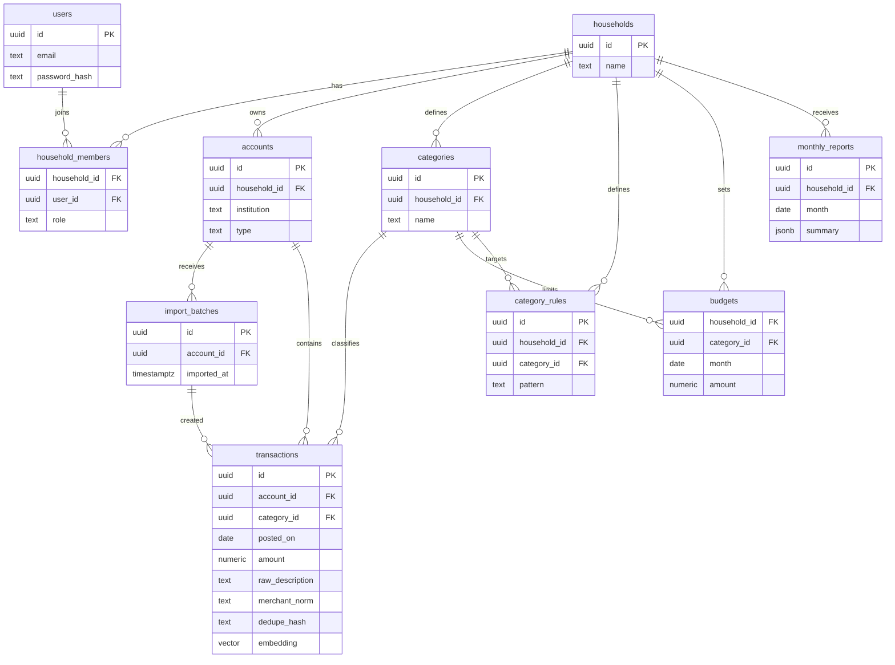
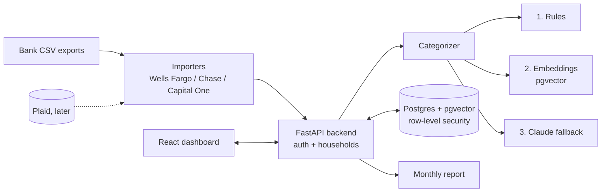

# BudgetApp: Initial Design

## Summary
BudgetApp is a private budgeting app for a household. Users import transactions from bank and credit card CSV exports (Wells Fargo, Chase, Capital One), the app categorizes each one (gas, groceries, restaurants and so on), and a dashboard compares spending to the budget set for each category. Each month it produces a report on how the household did and which budgets need adjusting.

**Goals**
- Replace manual spreadsheet tracking for two people sharing finances.
- Categorize automatically using rules, then embedding similarity, then an LLM fallback, and learn from corrections.
- Keep financial data safe: runs locally, no bank credentials stored, no real data in the repo.
- Support many households, each with only its own data (Postgres row-level security).

## Initial ERD

## Rough system design

Everything runs in Docker Compose on one local machine. It is reachable only on localhost, or over a private VPN such as Tailscale for the second user.

## Initial daily goals
| Date | Goal |
|---|---|
| Nov 18-19 | Finish this design, pitch, make repo public |
| Nov 20-22 | Docker Compose, schema, auth, households, RLS, seed data |
| Nov 23-26 | CSV importers, dedupe, transactions page |
| Nov 27-29 | Categorizer, budgets, dashboard. Working demo |
| Nov 30 | Present in class |
| Dec 1-5 | Feedback, monthly report, tests |
| Dec 6-10 | Demo GIF, final report, submit |
